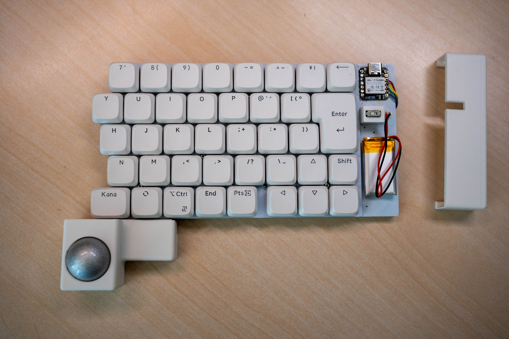
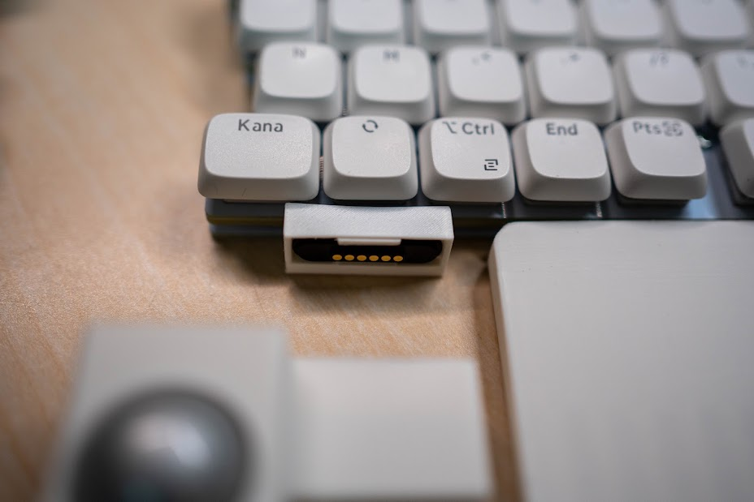

# tws_lp_jis60 用 着脱式トラックボールドック（ハードウェア）

ドックの設計バージョン：v1.0（ファームウェアのバージョンとは別です）

---

## 1. 概要

### 何をどこに取り付けるものか

分割無線キーボード [tws_lp_jis60](https://github.com/b-sky-lab/tws_lp_jis60)（ZMK、Seeed XIAO nRF52840 搭載）の**右手側**に、PMW3610 光学センサーを使った 25mm トラックボールを追加するドックです。

- ドック側には MCU も電池もありません。センサー基板をキーボード右手側の XIAO に SPI で直結し、ZMK が右手側（セントラル）でポインティングデバイスとして扱います
- キーボードとドックはマグネット式ポゴピンコネクタ（6ピン）で着脱します
- キーボード側の改造は、ブラケット1部品の取り付け、スペーサ1本の交換、6本の配線です

### 外観と取り付け方法

- ドックはキーボード右手側の**手前左**に付きます。ボールの中心はキーボード左端の延長線上、スペースキー中心から約 10.7mm 左、キーボード前縁から 23mm 手前です（親指を伸ばした位置）
- ドック外形：幅 62.7mm、奥行き 40.5mm、天面高さ 26.0mm、ボール頂点 35.6mm（いずれも机面から）
- 3D プリント部品は3つです
  - **A ブラケット**：キーボードの前縁に付ける部品。メス側（パッド側）コネクタを内蔵します。腕の先のリングをキーボードのスペーサ H4 とボトムプレートの間に挟み、舌をスペースキーと変換キーの間の隙間に差し込んで固定します
  - **B 上部品**：ボールの受け（カップ）と、A の箱を覆うフード。オス側（ポゴピン側）コネクタを内蔵します
  - **C 底板**：B の下に付け、センサー基板を挟み込みます
- 取り付けは、ドック（B＋C）をキーボード前縁の A に寄せるだけです。コネクタの磁石で吸着し、コネクタ周りの互い違いの枠が噛み合って位置が決まります。A の箱の裏面とフードの後面は同一面になります

全体像（右手側キーボードと、取り外したドック）：

写真のキーキャップは LOFREE Flow Lite JIS です。キーの大きさを優先して選んでいるため、刻印はこのファームウェアの割り当てと一致しないキーがあります（例：右手側の親指の「Kana」はスペース）。実際の割り当てはファームウェアの資料のキーマップを参照してください。



コネクタ部（キーボード前縁に付けた A ブラケットとメス側コネクタ）：



---

## 2. 購入部品の一覧

| 部品名 | 型番や仕様 | 数量 | 購入先の例 | 備考 |
|---|---|---|---|---|
| トラックボール | Keychron トラックボール（SKU: TRB-3）、直径 25mm | 1 | Keychron 日本公式 https://keychron.jp/products/keychron-trackball?variant=55097814090100 | 設計はこのボールで行った。別製品を使う場合は直径の差で開口径の調整が要る可能性あり（4章） |
| ボール支持球 | ジルコニア（ZrO2）セラミックボール φ2.5mm | 3 | Amazon（uxcell、ASIN B0CCHYRSBY、30個入り） | B の座に圧入。接着不要 |
| マグネット式ポゴピンコネクタ | 6ピン、ピッチ 2.3mm、オス・メス1組。本体 26.5×6.0mm、つば 28.5×8.0mm、つば厚 1.0mm（実測）、合わせ面からつばまで 0.9mm（実測）、磁石 φ5.0（N・S） | 1組 | Amazon（ASIN B0D1KSS9JW、「6ピン」を選択） | メスの合わせ面中央に凸、オスに凹があり、はめると隙間なく接する。寸法は購入品で実測すること |
| センサー基板・センサー IC・レンズ | PMW3610 ブレイクアウト基板（hidsh 版、元設計 siderakb/pmw3610-pcb）、PixArt PMW3610、レンズ。基板外形 23.5×31.5mm、厚さ 1.8mm（実測）、四隅に M3 穴。レンズ実測 8.2×13mm、基板上面から 2.5mm | 1式 | BOOTH https://booth.pm/ja/items/7066618 | まとめて購入。センサー IC は自分ではんだ付けする（6章） |
| 配線材 | 耐熱電子ワイヤー 1m×10色、導体外径 0.36mm（AWG28 相当）（秋月 通販コード 111640） | 6色を使用 | 秋月電子 https://akizukidenshi.com/catalog/g/g111640/ | 長さは5章 |
| 熱収縮チューブ | φ1.5mm（秋月 通販コード 106788） | 適量 | 秋月電子 https://akizukidenshi.com/catalog/g/g106788/ | コネクタ端子（ピッチ 2.3mm）間の短絡防止 |
| 熱圧入インサート | 真鍮ローレットナット M3、長さ 5.7mm、外径 4.6mm | 5 | Amazon（uxcell、ASIN B0CCCW13G4） | B に4個（基板固定用）＋1個（フード固定用） |
| 皿ねじ | M3×8 ステンレス | 5 | Amazon（ASIN B082KZX5H6）など | C から B のインサートへ |
| 丸スペーサ | M2×4mm | 1 | 遊舎工房 https://shop.yushakobo.jp/products/a0800c2 | キーボードの H4 のスペーサ（元は 5mm）と交換し、A のリング（1.0mm）を挟む |
| スペーサ固定ねじ | M2×4mm スリムヘッド | 0（流用） | — | キーボード付属のものをそのまま使う |
| 絶縁テープ | カプトン（ポリイミド）テープ | 適量 | 秋月電子 | 配線の絶縁・固定 |

工具・消耗品：はんだごて（インサートの熱圧入にも使用）、はんだ、ノギス。

---

## 3. 3D プリント部品の一覧

| 部品名 | ファイル名 | 数量 | 材料 | 向き | 備考 |
|---|---|---|---|---|---|
| A ブラケット | `stl/A_bracket.stl` | 1 | PLA | 腕を下にして平置き | 腕・舌 1.4mm、リング 1.0mm。コネクタはキーボード側から押し込み、リブで抜け止め |
| B 上部品 | `stl/B_upper_body.stl` | 1 | PLA | 天面を上にした正立 | 印刷後にインサート5個、支持球3個を入れる |
| C 底板 | `stl/C_bottom_plate.stl` | 1 | PLA | 底面を下にして平置き | センサー下の袋穴は皮 0.4mm |

3部品を組み立て位置に置いた STEP（Fusion などで開ける）：`step/trackball_dock_assembly.step`

印刷設定は特別なものは不要です。作者は可変積層ピッチを使い、インフィルやサポートなどはスライサーの初期設定のまま印刷しました。

### 設計スクリプト（`build_dock.py`）

STL を作り直したい場合（寸法を変えたい場合）に使います。STL をそのまま印刷するだけなら不要です。

| 項目 | 内容 |
|---|---|
| バージョン | v1.0（リポジトリの STL はこのスクリプトの出力） |
| 必要なもの | Python 3.11〜3.14、CadQuery 2.x（`pip install cadquery` で依存ライブラリ OCP も入る。追加のパッケージは不要） |
| 動作確認した環境 | Linux（x86_64）、Python 3.13、CadQuery 2.8.0 |
| 未確認の環境 | Windows、macOS（CadQuery は対応を表明しているが、作者は未確認） |
| 実行時間 | 約 10〜15 秒（上記環境） |

手順：

```
python -m venv venv
# Linux / macOS
source venv/bin/activate
# Windows
venv\Scripts\activate

pip install cadquery
python build_dock.py
```

- スクリプトを置いたフォルダで実行してください。そのフォルダに `out/` が作られ、次のファイルが出力されます
  - `A_bracket.stl`、`B_upper_body.stl`、`C_bottom_plate.stl`（印刷用）
  - `trackball_dock_assembly.step`（3部品を組み立て位置に置いた STEP）
- 実行時に部品間の干渉やねじ穴周りの肉厚などを自動で検査し、最後に `SELF-CHECK PASSED` と表示されます。`FAILED` と出た場合は、その上の `[NG ]` の行が問題箇所です
- 実行中に `FutureWarning: save will be removed in the next release.` という警告が出ますが、出力には影響しません
- 寸法はすべてスクリプト先頭の `P = dict(...)` にまとまっています（単位 mm）
- STEP の座標系は右手系です（x：右、y：キーボード奥、z：上。原点は右手側キーボードの左端・前縁・机面）。キーボードの傾き（2.3°）はモデル化していません

---

## 4. 寸法と調整

### センサーとボールの距離

| 項目 | 設計値 |
|---|---|
| レンズ上面 → ボール表面（ボールが支持球に載った状態） | **3.2mm** |
| 基板上面 → ボール表面 | 5.7mm（パラメータ `pcb_to_surface`） |
| 基板上面 → レンズ上面 | 2.5mm（実測） |

最終値 3.2mm は実機で決めた値です。これより近いとボールを強く押したときに追従が止まり、さらに近いと追従しませんでした。距離は「ボールが3つの支持球に載った実際の位置」で測った値です（ボールは球面の中心に浮かず、支持球の上に載ります）。

距離を変える場合は `pcb_to_surface` を ±0.3〜0.5mm ずつ変え、B だけ刷り直してください。

### 公差・はめあいの注意点

| 箇所 | 設計値 | 注意 |
|---|---|---|
| ボールの開口 | φ25.2（ボール φ25.0）。開口の段はボール中心の 1.5mm 上から高さ 0.8mm、入口に 0.6mm の面取り | 印刷で穴は小さめに出る。φ25.15 では軽いスナップ（裏返しても落ちない）になった。印刷後にボール径を下回るとボールが入らない。きつい・緩い場合は `snap_opening` を 0.05mm 刻みで調整 |
| ボールと球面の隙間 | 全周 1.0mm（球面 r13.5） | ボールが支持球以外に触れないための値 |
| 支持球の座 | 穴 φ2.1 × 深さ 1.9（台座上面から）、台座 φ3.2 × 高さ 0.4 | 圧入。球の中心が穴の縁より 0.65mm 奥に入る。浅いと抜ける。球の頂点は球面から 1.0mm 出る |
| 支持球の配置 | ボール底から 50°、方位 60°/180°/300° | 右手の親指で右へ押す力を2点で受ける向き |
| 熱圧入インサートの穴 | φ4.3 × 深さ 6.5、入口面取り 0.5 | 印刷で約 0.2mm 縮み φ4.1 前後になる。冷間では入らない（正常） |
| 底板の皿穴 | φ3.4、皿 φ6.5 | M3 皿ねじ用 |
| コネクタの収まり | 隙間 0.1（片側 0.05） | A は上下のリブ（各 0.2mm、幅 20mm）で通路を 7.8mm に狭め、つば（8.0mm）を一度押し通して抜け止め。B は C の突起（幅 20 × 奥行 1.2 × 高さ 1.9）がつばの後ろを押さえる |
| コネクタ周りの枠 | 肉厚 1.0、突き出し 0.6、逃げ 0.75 | 逃げは首（0.9mm）より小さくすること。大きいと相手側コネクタのつばに当たる |
| コネクタの高さ | 中心が机面から 8.2mm | つばの下端（4.1）が A の舌（2.6〜4.0）より上にくる高さ |
| センサー基板の下 | C に深さ 1.2 の逃げ（四隅の M3 穴周りだけ座）、センサー本体の下は袋穴（皮 0.4、余裕 0.4） | 基板の裏に部品とセンサー本体（基板下面から 2.3mm）が出ているため |
| ブラケットの舌 | 幅 19mm、厚さ 1.4mm | キーボードのスイッチ軸受けの間（実測 19mm 強）に入る幅 |
| キーボード H4 の位置 | KiCad データより 2mm 左（実測） | A のリング位置に反映済み |

---

## 5. 配線

### XIAO 側の接続先

| 信号 | XIAO の端子 | nRF52840 のピン |
|---|---|---|
| VIN | 3V3 | — |
| GND | GND | — |
| SDIO | D8 | P1.13 |
| SCLK | D9 | P1.14 |
| nCS | D10 | P1.15 |
| MOTION | 裏面パッド NFC1 | P0.09 |

### ファームウェア

ファームウェア（ピン割り当て、devicetree・Kconfig の設定、ソースコードの場所）は本書では扱いません。ファームウェア側の資料にまとめています。

ファームウェアの資料：[リポジトリ直下の README.md](../README.md)（配線は「トラックボール (PMW3610) 対応」の章）

### マグネット式コネクタのピン割り当て

センサー基板の J1 の並び順をそのままコネクタのピン番号にしています（配線が交差しません）。

| コネクタのピン番号 | 信号 | センサー基板 J1 | XIAO 側 |
|---|---|---|---|
| 1 | VIN（3.3V） | 1 VIN | 3V3 |
| 2 | GND | 2 GND | GND |
| 3 | SDIO | 3 SDIO | D8 |
| 4 | SCLK | 4 SCLK | D9 |
| 5 | nCS | 5 nCS | D10 |
| 6 | MOTION | 6 MOTION（基板の表記は Mot） | NFC1 |

コネクタのどちらの端を1番ピンとするかは決めていません。作者は、センサー基板 J1 とオス側コネクタを、互いに近い端子から順につないでいます（線が交差しない向き）。メス側は、はんだ付けの前に磁石で結合させた状態で、オス側と接触するピンに同じ番号の印を付けてから配線してください。

### 線の長さと経路

| 区間 | 長さ | 経路 |
|---|---|---|
| ドック側：センサー基板 J1 → オス側コネクタ | 経路に合わせて適宜（目安 約 60mm） | J1 のスルーホールに上から挿してはんだ → B の基板ポケット右辺の溝 → 配線室への開口（幅 6.5 × 高さ 5.9、底まで開いている） → オス側コネクタの足 |
| キーボード側：メス側コネクタ → XIAO | 経路に合わせて適宜 | メス側コネクタの足 → A の箱の中で右に寄せる → 舌の配線溝（幅 6、深さ 0.7） → キーボードの隙間（スペースキーと変換キーの間） → ボトムプレート上面 → XIAO の各端子（NFC1 は裏面） |

キーボード側の線は舌の溝（幅 6mm、底が机面から 3.3mm）を通り、キーボード基板の下面（4.6mm）の下をくぐります。2章の配線材（秋月 111640）で収まることを実機で確認しています。別の線を使う場合は、被覆を含む外径が約 1.3mm 以下で、6本が幅 6mm の溝に並ぶことを確認してください。

### 参考：既存の改造（ドックには不要）

作者のキーボードには、XIAO 裏面の RESET パッドと電池の GND の間にスライドスイッチ（IS-2235-G）を付ける改造がしてあります。トラックボールドックとは独立した改造で、ドックの再現には不要です。トラックボールの配線では RESET を使いません。この改造の配線方法・目的は本書の対象外とします。

---

## 6. 組み立て手順

1. **ファームウェアを書き込む**
   キーボード右手側に、このリポジトリのファームウェアを書き込みます（手順は [ファームウェアの資料](../README.md) を参照）。センサー未接続でもキーボードとして起動することを先に確認してください
2. **部品を印刷する**
   A・B・C を印刷します
3. **B に金物を入れる**
   M3 インサート5個をはんだごてで熱圧入します。インサートにこて先を差し込み、溶け始めたら垂直にゆっくり押し、面一で止めて冷まします。続いて支持球3個を座に押し込みます（接着不要）。3つの出っ張りが揃っていることを確認します
4. **センサー基板を組む**
   - センサー IC は**基板に密着させてはんだ付け**します。浮いていると、レンズとボールの距離が設計値からずれて追従しなくなります
   - **JP1 は 1-2 を短絡**します（基板表記「[1-2 3] VIO=VIN」。センサーの I/O 電圧を XIAO の 3.3V に合わせる設定）
   - レンズを取り付けます。レンズの位置決めの足が基板の裏に約 1mm 突き出します。この足は手順5の動作確認が済んでから、はんだごての平らな面で先端を基板裏に押しつぶして平らにします（熱かしめ）。そのままでは C の袋穴に収まりません
5. **センサー基板を単体で動作確認する**
   J1 から XIAO へ仮配線し、USB 接続でカーソルが動くことを確認します。軸の向きや速度が合わない場合は、ファームウェアの資料の「感度・向きの調整」で合わせます。動かない場合は、配線診断版のファームウェア（`./build.sh probe`）で配線とセンサーの読み取り状態を確認できます。確認後、手順4のレンズの足の熱かしめを行います
6. **ドック側の配線**
   J1 に線6本をはんだ付け → 線を B の溝と開口に通す → オス側コネクタの足にはんだ付け → オス側コネクタを配線室側から窓へ前向きに押し込む（つばが壁の裏に掛かる）
7. **ドックを閉じる**
   センサー基板を B の基板ポケットの座に置き、C を被せて M3×8 皿ねじ5本で締めます。C の突起がオス側コネクタのつばの後ろに入り、コネクタが固定されます。最後にボールを上から押し込みます
8. **キーボード側の配線**
   メス側コネクタの足に線6本をはんだ付け → A の箱にキーボード側から押し込む（リブを乗り越えて止まる） → 線を箱の中で右に寄せ、舌の溝へ
9. **A をキーボードに取り付ける**
   キーボードのボトムプレートを外し、H4 のスペーサを 4mm に交換して A のリングを挟みます。舌をスペースキーと変換キーの間の隙間に差し込み、線を XIAO の各端子へはんだ付けします（NFC1 は裏面パッド）。ボトムプレートを戻します
10. **結合して確認する**
    電源を切った状態でドックを A に寄せて磁石で結合し、電源を入れて動作を確認します

### はんだ付けの注意点

- センサー IC は基板に密着させる（距離が変わると追従しない）
- JP1 は 1-2 を短絡する
- コネクタの足はピッチ 2.3mm と狭く、隣と短絡しやすい。φ1.5mm の熱収縮チューブを先に通しておく
- NFC1 は XIAO 裏面の小さなパッド。仮止めが難しいので、動作確認の段階で本はんだしてよい
- コネクタの1番ピンの向きを、オス側・メス側で取り違えないこと（5章）

---

## 7. 注意点と既知の問題

### 使用上の注意

- **通電中にマグネットコネクタを付け外ししないこと**。電源を切ってから着脱してください
- ボールの取り出し：開口がボール径とほぼ同じなので、裏返しても落ちないことがあります。その場合は C を外し、センサー基板とセンサーの隙間から薄いものを差し込んでボールを押し上げます
- 磁力が強いと感じる場合：外すときは真っ直ぐ引かず、ドックを横にずらしてください

### 既知の問題・未確認事項

- 長期使用での支持球周りの摩耗、PLA のクリープによる座の緩み：未確認
- 電池持ちへの影響：未確認
- Keychron TRB-3 以外のボールを使う場合の直径の差：開口径（`snap_opening`）の調整が必要になる可能性あり

---

## 8. ライセンスと出典

### 本ディレクトリ（hardware/）のライセンス

| 対象 | ライセンス | ファイル |
|---|---|---|
| 3D モデル（`stl/`、`step/`）と本書 | CC BY 4.0（クレジット表示のみが条件。商用利用・改変も可） | `LICENSE-CC-BY-4.0.md` |
| 設計スクリプト `build_dock.py` | MIT | `LICENSE-MIT.txt` |
| ファームウェア（`hardware/` 以外のファイル） | 本書の対象外。fork 元にライセンスの記載がないため、明示していない | — |

Copyright (c) 2026 neko1000nin

### 設計スクリプトが使うライブラリ（利用者が別途インストールするもの。本リポジトリには同梱しない）

| ライブラリ | ライセンス |
|---|---|
| CadQuery | Apache License 2.0 |
| cadquery-ocp（CadQuery が使う OpenCASCADE の Python バインディング） | Apache License 2.0（中に含まれる OpenCASCADE Technology は LGPL 2.1 ＋例外） |

### 参照した外部設計・資料

| 名称 | 内容 | URL |
|---|---|---|
| tws_lp_jis60（b-sky-lab） | 取り付け先のキーボード | https://github.com/b-sky-lab/tws_lp_jis60 |
| tws_lp_shield_module（b-sky-lab） | キーボードの ZMK シールド定義（ファームウェアの fork 元） | https://github.com/b-sky-lab/tws_lp_shield_module |
| siderakb/pmw3610-pcb | PMW3610 ブレイクアウト基板の元設計 | https://github.com/siderakb/pmw3610-pcb |
| hidsh/pmw3610-pcb | 購入したブレイクアウト基板の設計データ（siderakb/pmw3610-pcb の fork、CERN-OHL-P v2） | https://github.com/hidsh/pmw3610-pcb |
| badjeff/zmk-pmw3610-driver | ZMK 用 PMW3610 ドライバ | https://github.com/badjeff/zmk-pmw3610-driver |
| Nape（men-bou） | 参考にしたトラックボールのビルドガイド | https://men-bou.net/nape-trackball-buildguide/ |
| ZMK Pointing Devices | ZMK のポインティング設定 | https://zmk.dev/docs/development/hardware-integration/pointing |

各外部設計のライセンスは、それぞれのリポジトリの記載に従ってください。
